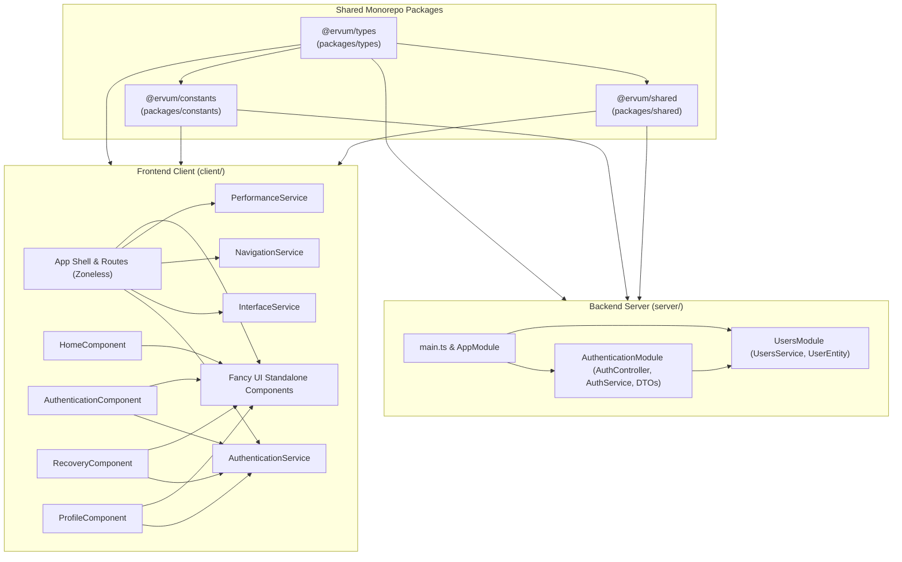
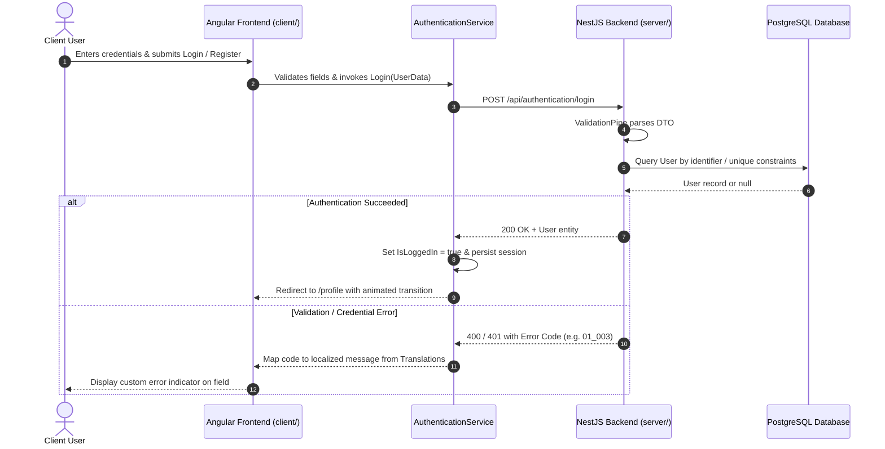

# Monorepo Architectural Topography & System Map

This document establishes the authoritative structural topography, module relationships, and data pipelines for the Portfolio monorepo. Every autonomous agent or human contributor MUST consult this document prior to making modifications to understand component responsibilities, dependency flows, and Single Source of Truth (SSOT) mappings from top to bottom.

---

## 1. Monorepo Structural Overview & Dependency Graph

The repository is organized as a unified TypeScript monorepo managed with `pnpm` workspaces. Domain logic, data contracts, and environment configuration are completely decoupled from framework plumbing, enabling robust cross-package sharing between frontend and backend.

```
├── .agents/                                # Agent standards, skills, and architectural maps
│   ├── AGENTS.md                           # Monorepo coding rules and workspace standards
│   ├── ARCHITECTURE.md                     # This document (top-to-bottom architectural reference)
│   └── MODIFICATIONS.md                    # Chronological ledger of repository modifications
├── client/                                 # Frontend Angular 20 application (SSR)
│   ├── AGENTS.md                           # Frontend TypeScript, Angular, HTML & SCSS coding standard
│   ├── src/
│   │   ├── main.ts                         # Client bootstrap entry point
│   │   ├── main.server.ts                  # Server-side bootstrap entry point
│   │   ├── server.ts                       # Express SSR server handler
│   │   ├── index.html                      # Root HTML shell with theme initialization & Google Fonts
│   │   ├── app/
│   │   │   ├── app.ts                      # Root application component, floating top bar & dock shell
│   │   │   ├── app.routes.ts               # Client routing configuration with animation guards
│   │   │   ├── core/                       # Core singletons, services, and internationalization
│   │   │   │   ├── guards/                 # Route guards (AnimationGuard)
│   │   │   │   ├── services/               # Core services (Authentication, Background, BackgroundPointer, Interface, Navigation, Performance)
│   │   │   │   └── internationalization/   # Translation dictionaries (default, es)
│   │   │   ├── shared/                     # Reusable UI component library & directives
│   │   │   │   ├── components/standalone/  # Custom standalone UI elements & 7-layer procedural backgrounds
│   │   │   │   ├── directives/             # Custom directives (Typewriter, SlideUpDown via WAAPI)
│   │   │   │   ├── styles/                 # Centralized SCSS variables, layout, mixins, typography, shapes
│   │   │   │   └── utilities/              # Client-side helper utilities (icons.ts -> ResolveIconVariants, GetIconVariantStyles)
│   │   │   ├── home/                       # Portfolio landing hero presentation
│   │   │   ├── authentication/             # User sign-in, registration, and form validation
│   │   │   │   └── recovery/               # Multi-field credential recovery flow
│   │   │   └── profile/                    # Authenticated user profile view
│   │   ├── assets/icons/                   # 56 dual-state vector SVG icons (<name>.svg & <name>-filled.svg)
│   │   └── public/                         # Public web assets and manifest.webmanifest
│   └── angular.json                        # Angular application build, SSR, and asset configuration
├── server/                                 # Backend NestJS application
│   ├── src/
│   │   ├── main.ts                         # Server bootstrap, global validation pipe, and prefix
│   │   ├── app.module.ts                   # Root NestJS module and TypeORM database connection
│   │   ├── app.controller.ts               # Health check and root endpoints
│   │   ├── app.service.ts                  # Root application service
│   │   ├── configuration/                  # Server configuration constants
│   │   ├── users/                          # User entity, service, and controller
│   │   │   ├── users.entity.ts             # TypeORM User entity schema
│   │   │   ├── users.service.ts            # User persistence, query, and lookup operations
│   │   │   └── users.controller.ts         # User management endpoints
│   │   └── authentication/                 # Authentication feature module
│   │       ├── authentication.module.ts    # Authentication module registration
│   │       ├── authentication.controller.ts# Login, registration, and recovery endpoints
│   │       ├── authentication.service.ts   # Authentication business logic
│   │       └── dto/                        # Data Transfer Objects (Login, Register, Recover)
│   └── test/                               # Integration and end-to-end test suites
├── packages/                               # Shared workspace packages
│   ├── constants/                          # Single Source of Truth (SSOT) constants (@ervum/constants)
│   │   └── src/index.ts                    # Priority mappings, icon paths, breakpoints, and hero constants
│   ├── types/                              # Shared domain types, interfaces, and contracts (@ervum/types)
│   │   └── src/index.ts                    # Error registries, DTO interfaces, icon names, and UI contracts
│   └── shared/                             # Runtime environment and proxy configuration (@ervum/shared)
│       ├── src/index.ts                    # Dynamic port resolvers, proxy paths, and database defaults
│       └── src/secrets.ts                  # Dynamic secrets loader with fallback
├── .vscode/                                # IDE workspace integration
│   └── tasks.json                          # Structured tasks (Packages: Watch, Client: Start, Server: Start, Development: All)
├── docker-compose.dev.yml                  # Local PostgreSQL container service configuration
├── docker.env                              # Local PostgreSQL environment variables
├── database-up.mjs                         # Database readiness check, schema validation, and Docker Compose launcher
└── package.json                            # Root workspace scripts and workspace topology
```

### Architectural Dependency Hierarchy



---

## 2. Shared Packages Subsystem (`packages/`)

### `@ervum/constants` ([packages/constants/src/index.ts](file:///c:/Dev/Poseur/packages/constants/src/index.ts))
Centralizes shared constants and lookup mappings:
- **Badge Color Priority**: `FeatureBadgeColorPriorityMap` mapping `FeatureBadgeColorType` (`Green`, `Neutral`, `Red`) to display priority weights.
- **Icon Resolution Constants**: `IconsBasePath` (`'/assets/icons/'`), `IconFileExtension` (`'.svg'`), and `IconFilledSuffix` (`'-filled'`).
- **Responsive Viewport Constants**: `CompactViewportMaximumWidth` (`768`).
- **Route Transition, Atmosphere Lifecycle & Performance Probe Constants**: `RouteTransitionDurationMilliseconds` (`800`), `RouteTransitionEasing` (`'cubic-bezier(0.86, 0, 0.07, 1)'`), `ReducedEffectsFrameBudgetMilliseconds` (`28`), `ReducedEffectsProbeFrameCount` (`45`), `AtmosphereIdleTimeoutMilliseconds` (`2500`), `AtmosphereScrollSettleMilliseconds` (`120`), and `SoftwareRendererSignatures` (`['swiftshader', 'llvmpipe', 'softpipe', 'microsoft basic render', 'software', 'mesa offscreen']`).
- **Portfolio Hero Constants**: `HeroContactURL` (`'mailto:contact@ervum.dev'`) and `HeroTechnologyStack` (`['TypeScript', 'Angular', 'NestJS', 'PostgreSQL', 'Node.js', 'SCSS']`).
- **Validation & Authentication Constants**: `EmailValidationPattern`, `PhoneNumberValidationPattern`, `PhoneNumberMinimumDigits` (`6`), `PhoneNumberMaximumLength` (`15`), `PhoneNumberAllowedCharacters` (`'0123456789+-() '`), `PasswordMinimumLength` (`6`), `ErrorTooltipResetDelayMilliseconds` (`5000`), `AuthenticationRedirectDelayMilliseconds` (`500`), `AuthenticationTabSwitchErrorDelayMilliseconds` (`400`), `IsValidEmailAddress`, and `IsValidPhoneNumber`.
- **Procedural Background Constants**: `BackgroundAccentPalette` (6 Lumina/Obsidian Violet-Indigo stops: `#8b7cff`, `#5b47e0`, `#6e8efb`, `#c4b5fd`, `#4338ca`, `#a855f7`, aliased as `BackgroundGoldPalette`), `BackgroundLayerIDOrder` (`['Mesh', 'Aurora', 'Topographic', 'Cadastral', 'Blueprint', 'Silk', 'Spotlight']`), `BackgroundMotionModes` (`['Static', 'Ambient', 'Evolving']`), `BackgroundEvolvingTargetFPS` (`24`), `BackgroundLayerDescriptors`, `DefaultBackgroundLayersMap`, `CloneBackgroundLayersMap`, `SanitizeBackgroundConfiguration`, `RollRandomBackgroundLayers`, `DefaultPublicBackgroundConfiguration`, `DefaultAdminBackgroundConfiguration`, `DefaultVisitorBackgroundOverride`, `BackgroundTextDictionary`, `BackgroundMotionMultibuttonItems`, and `GetBackgroundModeMultibuttonItems`.

### `@ervum/types` ([packages/types/src/index.ts](file:///c:/Dev/Poseur/packages/types/src/index.ts))
Declares universal TypeScript interfaces, descriptors, and contracts shared across client and server:
- **General Types**: `Nullable<T>`, `Undefinable<T>`, `Voidable<T>`, `AnyFunction`, `StringBooleanType`.
- **Error Code Registry**:
  - `ErrorRegistry`: Centralized lookup map for deterministic API response codes.
  - `00_000`: General unexpected error.
  - `01_000`: Field cannot be empty.
  - `01_001`: Invalid email format.
  - `01_002`: Password length requirement unmet (< 6 characters).
  - `01_003`: Invalid credentials.
  - `01_004`: Account not found.
  - `01_005`: Username already taken.
  - `01_006`: Email already registered.
  - `01_007`: Phone number already registered.
  - `01_008`: Invalid phone number format.
- **Server Types & DTO Contracts**:
  - `ConfigurationType`, `DatabaseConfigurationType`, `SecretsType`, `ServerConfigurationType`.
  - `LoginData`, `RegisterData`, `FieldErrorDescriptor`, `RecoveryTargetType`.
  - Recovery contracts: `RecoverUsernameData`, `RecoverPhoneData`, `RecoverEmailData`, `RecoverPasswordData`, and their typed responses (`RecoverUsernameResponse`, `RecoverPhoneResponse`, `RecoverEmailResponse`, `RecoverPasswordResponse`, with structured `MatchedBy: string[]`).
- **Client & UI Contracts**:
  - `IconNameType`: Exhaustive union of all 28 base SVG icon names in `/assets/icons/`, paired with `FancyIconNameType`, `IconVariantType` / `FancyIconVariantType` (`'Stroked' | 'Filled'`), and `IconVariantsDescriptor`.
  - `SlideStateType` (`'In' | 'Out'`), `FancySidebarSideType` (`'Left' | 'Right' | 'Top' | 'Bottom'`), `FancySidebarModeType` (`'Viewport' | 'Container'`).
  - `FancyUIElementTypeType` (`'Primary' | 'Secondary'`), `FancyUIElementStyleType` (`'Standard' | 'Backgroundless' | 'Accent'`), `FancyUIElementFocusStateType`, `FancyUIElementLoadStatusType`.
  - `FancyMultibuttonItemType`, `FancyDropdownItemType`, `FancyButtonIconStateType`, `FancyTextboxOrderType`.
  - `BackgroundPalette`, `RGBColor` / `RGBColour`, `AuroraSphere`, `AtmospherePalettePairDescriptor`, `AtmosphereStateDescriptor`, `BackgroundLayerIDType`, `BackgroundMotionModeType`, `BackgroundConfigurationModeType`, `VisitorBackgroundPreferenceModeType`, `BackgroundScopeType`, `BackgroundLayerSettings`, `BackgroundLayerDescriptor`, `BackgroundLayersMap`, `BackgroundConfiguration`, `VisitorBackgroundOverride`, `BackgroundAccentPaletteStop`, `BackgroundTextDescriptor`, `FeatureBadgeDescriptor`.

### `@ervum/shared` ([packages/shared/src/index.ts](file:///c:/Dev/Poseur/packages/shared/src/index.ts))
Maintains runtime environment bridges and configuration resolvers:
- **Port Resolution**: `ServerPort = 6900`, `ClientPort = 4200`.
- **Proxy Configuration**: `ProxyURL = 'api'`, `SlashedProxyURL = '/api'`.
- **Database Fallbacks**: `DefaultSecrets` with local PostgreSQL defaults (`localhost:5432`, `Administrator`, `Database`).
- **Dynamic Configuration Resolvers**:
  - `GetSecrets()`: Reads optional `./secrets.js` dynamically with fallback to `DefaultSecrets`.
  - `ServerConfiguration`: Asynchronously resolved `Promise<ServerConfigurationType>` consumed during backend startup.
  - `ClientConfiguration`: Synchronous `ConfigurationType` consumed by client services.

---

## 3. Backend Server Subsystem (`server/`)

### Bootstrap & Configuration Layer
- **`server/src/main.ts`**:
  - Initializes the NestJS application instance (`NestFactory.create(AppModule)`).
  - Resolves `ServerConfiguration` asynchronously to bind port and global proxy prefix (`Configuration.ProxyURL`).
  - Implements global `ValidationPipe` with custom `exceptionFactory` mapping `ValidationError[]` constraints directly to centralized error codes (`property:code`).
  - Listens globally on `0.0.0.0` at the configured port.
- **`server/src/app.module.ts`**:
  - Registers `TypeOrmModule.forRootAsync` utilizing `ServerConfiguration` credentials.
  - Imports feature modules: `UsersModule` and `AuthenticationModule`.
  - Registers `AppController` and `AppService`.

### Feature Modules
- **`UsersModule` (`server/src/users/`)**:
  - **`users.entity.ts`**: `User` entity declaring `@PrimaryGeneratedColumn() ID`, unique `@Column() Email`, unique `@Column() PhoneNumber`, unique `@Column() Username`, and `@Column() Password`.
  - **`users.service.ts`**: Handles TypeORM database queries, user creation, and lookup helpers (`FindByUsername`, `FindByEmail`, `FindByPhoneNumber`, `FindByUserIdentifier`).
  - **`users.controller.ts`**: REST controller exposing user-related query endpoints.
- **`AuthenticationModule` (`server/src/authentication/`)**:
  - **`authentication.controller.ts`**:
    - `POST /api/authentication/register`: Enforces unique constraint checks against username (`01_005`), email (`01_006`), and phone number (`01_007`), returning batched `BadRequestException` on conflicts.
    - `POST /api/authentication/login`: Verifies user identifier against password, returning `UnauthorizedException('01_003')` on failure.
    - `POST /api/authentication/recover/username`: Multi-field recovery by phone number and/or email.
    - `POST /api/authentication/recover/phone`: Recovery by username and/or email.
    - `POST /api/authentication/recover/email`: Recovery by username and/or phone number.
    - `POST /api/authentication/recover/password`: Retrieves password by user identifier.
  - **`authentication.service.ts`**: Supporting authentication domain logic.
  - **`dto/`**: Strongly-typed request validation payloads:
    - `LoginDTO`: Requires non-empty `UserIdentifier` and `Password`.
    - `RegisterDTO`: Requires `Email`, `PhoneNumber`, `Username`, and `Password` (min 6 characters).
    - `RecoverDTO`: Declares `RecoverUsernameDTO`, `RecoverPhoneDTO`, `RecoverEmailDTO`, and `RecoverPasswordDTO`.

---

## 4. Frontend Client Subsystem (`client/`)

### Application Shell & State Management
- **Angular 20 Zoneless Standalone Architecture**: Utilizes standalone components, `provideZonelessChangeDetection()` (zero `zone.js` or `@angular/animations` runtime overhead), signals (`signal`, `computed`), and `inject()` dependency injection.
- **`client/src/app/app.ts`**:
  - Root shell managing route transitions, keyboard tab navigation loops (`HandleTabLoop` via a zero-overhead native `document` `'keydown'` listener that short-circuits non-`Tab` keys), responsive viewport observation (`IsCompactViewport` via `matchMedia`), and theme switching.
  - Renders a unified floating glass top bar (`.Shell-TopBar`) structured as a 3-column CSS Grid (`minmax(0, 1fr) auto minmax(0, 1fr)`): start cluster (collapsible back button + brand logo + `Poseur` wordmark), centered horizontal navigation dock (`.Shell-Dock` containing `RouteSelector-Multibutton`), and end cluster (language dropdown showing full names on desktop and `EN`/`ES` codes on compact viewports `<= 768px`, background designer drawer toggle button (`Icon = "layers"`), and theme toggle).
  - Binds custom interactive elements: `FancyMinibutton`, `FancyDropdown`, `FancyMultibutton`, `FancyTooltip`, `FancySidebar`, `BackgroundDesignerPanel`, and `Backgrounds`.
  - Implements circular ripple view transitions during theme toggling.
- **`client/src/app/app.routes.ts`**:
  - Route declarations for `home`, `authentication`, `authentication/recovery`, and `profile`.
  - Guards route changes with `AnimationGuard` to orchestrate smooth exit/enter view animations via `SlideUpDownDirective` (native Web Animations API `Element.animate()`).

### Core Services (`client/src/app/core/services/`)
- **`AuthenticationService` (`authentication/authentication.ts`)**:
  - Manages authenticated state signal (`IsLoggedIn`).
  - Reads initial session state from `sessionStorage` and `RememberMe` cookie.
  - Dispatches HTTP requests to `/api/authentication/login`, `/api/authentication/register`, and `/api/authentication/recover/*`.
- **`BackgroundService` (`background/background.ts`)**:
  - Manages the 7-layer procedural background configuration (`PublicDefaultConfiguration`, `AdminConfiguration`), visitor preference override (`VisitorOverride` persisted to `localStorage`), session random roll (`PublicRandomRoll` persisted to `sessionStorage` and hydrated via SSR `TransferState`), effective active layers (`ActiveLayers`), and slide-out designer drawer state (`IsDrawerOpen`).
- **`BackgroundPointerService` (`background/background-pointer.ts`)**:
  - Provides shared pointer interpolation (`--pointer-x`, `--pointer-y`, `--pointer-distance`, `--pointer-angle`, `--pointer-x-pct`, `--pointer-y-pct`) and contention lifecycle tracking (`.Is-Idle`, `.Is-Scrolling`, `.Is-Hidden`) for all procedural background layers via a single `ResizeObserver` and self-parking `requestAnimationFrame` loop.
- **`InterfaceService` (`interface/interface.ts`)**:
  - Governs interface theme (`Primary` Lumina dark / `Secondary` Obsidian light), language (`Language`), effective typewriter state (`EffectiveTypewriter`, disabled when `PerformanceService.IsReducedEffects()` is active), and `:root.Is-Transitioning` synchronization during route/theme transitions.
  - **Third-Party Extension Defense**: Implements `BlockDarkModeExtensions` to prevent external browser extensions (such as Dark Reader) from altering design system styles.
  - Cookie lifecycle helpers (`GetCookie`, `DeleteCookie`).
- **`NavigationService` (`navigation/navigation.ts`)**:
  - Coordinates animated route transitions (`RouteTransitionDurationMilliseconds`) and history navigation.
- **`PerformanceService` (`performance/performance.ts`)**:
  - Detects software/non-hardware-accelerated rendering via WebGL `UNMASKED_RENDERER_WEBGL` inspection (`SoftwareRendererSignatures`) and a 45-frame `requestAnimationFrame` budget probe (`> 28ms` median), caching the result in `sessionStorage` (`'Interface-Effects'`) and toggling `:root.Effects--Reduced` to switch `.Atmosphere-Sphere` to blurless multi-stop radial gradients and bypass heavy keyframe/view-transition animations while preserving top-level `backdrop-filter` glass blurs.

### Internationalization Layer (`client/src/app/core/internationalization/`)
- **`default.ts`**: Default English dictionary (`TranslationDictionary`) with brand title (`PageName: 'Poseur'`), hero copy (`HeroHeadlineAccent: 'Ervum.'`), authentication/profile strings, recovery strings, and error code translations (`Error_00_000` through `Error_01_007`).
- **`es.ts`**: Complete Spanish translation dictionary (`PageName: 'Poseur'`).
- **`index.ts`**: Exports unified `Translations` dictionary.

### Views & Pages
- **Home View (`client/src/app/home/`)**:
  - Portfolio landing hero inside a glassmorphic `FancyContainer` featuring an eyebrow status badge with pulsing brand indicator, `Space Grotesk` display headline with violet-indigo gradient accent (`Ervum.`), tagline, primary (`Style = "Accent"`) and secondary (`Style = "Backgroundless"`) CTAs, and technology stack chips (`HeroTechnologyStack`).
- **Authentication View (`client/src/app/authentication/`)**:
  - Tabbed glassmorphic card with contextual eyebrow (`Poseur`) + dynamic title (`Welcome Back` / `Create Account`), switching between `Sign In` and `Sign Up` with brand-accent primary submission.
  - Comprehensive client-side form validation mapping field errors to localized messages.
- **Recovery View (`client/src/app/authentication/recovery/`)**:
  - Step-by-step account recovery allowing users to recover Username, Phone, Email, or Password, presenting recovered credentials in a brand-accented result card.
- **Profile View (`client/src/app/profile/`)**:
  - Displays authenticated user avatar emblem, localized status text, and session sign-out controls.

### Shared Styles & Utilities (`client/src/app/shared/`)
- **`styles/variables.scss`**: Central design tokens (`$Font-Display`, fluid typography scale, `--space-1`..`--space-8`, `--radius-surface`, `--radius-control`, `--duration-icon-swap`, `--accent-brand*`, `--focus-ring`, `--elevation-surface`).
- **`styles/mixins.scss`**: `@function IconURL($Name, $Variant)`, `@mixin DualStateIcon`, `@mixin IconFilled`, `@mixin MaskedIcon`, `@mixin CreateTransition`, and `@mixin SynchronizeStates`.
- **`styles/layout.scss`**: Responsive `@mixin Compact`, symmetric `@mixin PageShell`, `@mixin GlassSurface`, and `@mixin FocusRing`.
- **`utilities/icons.ts`**: Centralized `ResolveIconVariants(IconName)` and `GetIconVariantStyles(IconName)` helpers resolving `IconNameType` to stroked (`/assets/icons/<name>.svg`) and filled (`/assets/icons/<name>-filled.svg`) CSS mask variables.
- **`utilities/typewriter.ts`**: Vsync-coalesced `TypewriterAnimator` driving delete and type phases from a single `requestAnimationFrame` elapsed-time loop instead of per-character `setTimeout` chains.

### Standalone Custom UI Library (`client/src/app/shared/components/standalone/`)
In strict compliance with workspace standards, native browser popups and unstyled controls are prohibited:
- **`FancyButton`** (`button/`): Custom themed button supporting `'Standard'`, `'Backgroundless'`, and `'Accent'` (violet-indigo brand CTA) styles with dual-state stroked/filled SVG mask icons.
- **`FancyDropdown`** (`dropdown/`): Custom glassmorphic select dropdown with dual-state SVG chevron mask, brand-accented active option indicator, and on-demand outside-click listener attached only while `IsOpen()` is `true`.
- **`FancyCheckbox`** (`checkbox/`): Custom animated checkbox component with filled SVG checkmark and brand-accent fill when checked.
- **`FancyMinibutton`** (`minibutton/`): Compact dual-state SVG-masked icon (or icon + label) button supporting `[Active]` state, `[Typewriter]` toggle, and `(Activate)` output, used for back navigation, background drawer toggling, designer actions, and theme toggling.
- **`FancyMultibutton`** (`multibutton/`): Multi-segment pill button with dual-state stroked/filled SVG icons, brand-accent active indicator, and vertical/horizontal orientation support.
- **`FancyTextbox`** (`textbox/`): Input component with dual-state SVG icon badge (filled when focused), brand-accent focus ring, dual-state password visibility toggle, and validation states.
- **`FancyTooltip`** (`tooltip/`): Floating contextual tooltip with explicit glass `backdrop-filter`.
- **`FancyContainer`** (`container/`): Glassmorphism card container that scopes `backdrop-filter: blur(var(--container-blur)) saturate(140%)` strictly to top-level glass surfaces (`:host-context(FancyContainer, .Shell-TopBar)` disables redundant nested blurs).
- **`FancyIcon`** (`icon/`): Standalone CSS-masked SVG icon component supporting `'Stroked'` and `'Filled'` variants and configurable pixel sizing.
- **`FancyToggle`** (`toggle/`): Accessible switch toggle (`role = "switch"`) with brand-accent active track and smooth thumb transition.
- **`FancySlider`** (`slider/`): Interactive range slider with filled brand-accent progress track, optional scale markers, and live thumb badge.
- **`FancySidebar`** (`sidebar/`): Slide-out glassmorphic drawer supporting `'Left' | 'Right' | 'Top' | 'Bottom'` anchoring, `'Viewport' | 'Container'` modes, backdrop dismissal, and `Escape` key closing.
- **`Backgrounds` & `BackgroundDesignerPanel`** (`backgrounds/`): Multi-layer procedural background stage (`<Backgrounds>`) orchestrating `<DeepBackground>` plus 7 independently configurable procedural layers (`<MeshBackgroundLayer>`, `<AuroraBackgroundLayer>`, `<TopographicBackgroundLayer>`, `<CadastralBackgroundLayer>`, `<BlueprintBackgroundLayer>`, `<SilkBackgroundLayer>`, `<SpotlightBackgroundLayer>`) powered by `shared/procedural.ts` (`SimplexNoiseField`, marching-squares contours, recursive quad subdivision, harmonic wave fields) and live-customized via `<BackgroundDesignerPanel>` inside the top-bar slide-out drawer.

---

## 5. End-to-End Data Pipeline



---

## 6. Single Source of Truth (SSOT) Directory

All shared configurations, ports, error codes, and credentials are centralized across `@ervum/constants`, `@ervum/types`, and `@ervum/shared`:

| Concept / Parameter | Identifier | Value | Declaring File |
| :--- | :--- | :--- | :--- |
| **Backend Port** | `ServerPort` | `6900` | `packages/shared/src/index.ts` |
| **Frontend Port** | `ClientPort` | `4200` | `packages/shared/src/index.ts` |
| **API Proxy Prefix** | `ProxyURL` / `SlashedProxyURL` | `'api'` / `'/api'` | `packages/shared/src/index.ts` |
| **Default DB Host** | `DefaultSecrets.Database.Host` | `'localhost'` | `packages/shared/src/index.ts` |
| **Default DB Port** | `DefaultSecrets.Database.Port` | `5432` | `packages/shared/src/index.ts` |
| **Default DB User** | `DefaultSecrets.Database.User` | `'Administrator'` | `packages/shared/src/index.ts` |
| **Default DB Name** | `DefaultSecrets.Database.Name` | `'Database'` | `packages/shared/src/index.ts` |
| **Badge Priority Map**| `FeatureBadgeColorPriorityMap` | `{ Green: 1, Neutral: 2, Red: 3 }` | `packages/constants/src/index.ts` |
| **SVG Icons Base Path**| `IconsBasePath` / `IconFileExtension` / `IconFilledSuffix` | `'/assets/icons/'` / `'.svg'` / `'-filled'` | `packages/constants/src/index.ts` |
| **Compact Breakpoint**| `CompactViewportMaximumWidth` | `768` | `packages/constants/src/index.ts` |
| **Route Transition** | `RouteTransitionDurationMilliseconds` / `RouteTransitionEasing` | `800` / `'cubic-bezier(0.86, 0, 0.07, 1)'` | `packages/constants/src/index.ts` |
| **Reduced-Effects Probe** | `ReducedEffectsFrameBudgetMilliseconds` / `ReducedEffectsProbeFrameCount` | `28` / `45` | `packages/constants/src/index.ts` |
| **Atmosphere Lifecycle** | `AtmosphereIdleTimeoutMilliseconds` / `AtmosphereScrollSettleMilliseconds` | `2500` / `120` | `packages/constants/src/index.ts` |
| **Hero Contact URL** | `HeroContactURL` | `'mailto:contact@ervum.dev'` | `packages/constants/src/index.ts` |
| **Hero Tech Stack** | `HeroTechnologyStack` | `['TypeScript', 'Angular', 'NestJS', 'PostgreSQL', 'Node.js', 'SCSS']` | `packages/constants/src/index.ts` |
| **Validation Bounds** | `PhoneNumberMinimumDigits` / `PhoneNumberMaximumLength` / `PasswordMinimumLength` | `6` / `15` / `6` | `packages/constants/src/index.ts` |
| **Error Reset Delay** | `ErrorTooltipResetDelayMilliseconds` | `5000` | `packages/constants/src/index.ts` |
| **General Error** | `ErrorRegistry['00_000']` | `'00_000'` | `packages/types/src/index.ts` |
| **Empty Field Error**| `ErrorRegistry['01_000']` | `'01_000'` | `packages/types/src/index.ts` |
| **Invalid Email** | `ErrorRegistry['01_001']` | `'01_001'` | `packages/types/src/index.ts` |
| **Short Password** | `ErrorRegistry['01_002']` | `'01_002'` | `packages/types/src/index.ts` |
| **Invalid Credentials**| `ErrorRegistry['01_003']` | `'01_003'` | `packages/types/src/index.ts` |
| **Account Not Found**| `ErrorRegistry['01_004']` | `'01_004'` | `packages/types/src/index.ts` |
| **Username Exists** | `ErrorRegistry['01_005']` | `'01_005'` | `packages/types/src/index.ts` |
| **Email Exists** | `ErrorRegistry['01_006']` | `'01_006'` | `packages/types/src/index.ts` |
| **Phone Exists** | `ErrorRegistry['01_007']` | `'01_007'` | `packages/types/src/index.ts` |
| **Invalid Phone** | `ErrorRegistry['01_008']` | `'01_008'` | `packages/types/src/index.ts` |

---

## 7. Operational Scripts, Tasks & Workflows

### Command Execution Reference
- **Database Readiness (`database-up.mjs`)**:
  - Dynamically imports `@ervum/shared` with graceful fallback to `DefaultSecrets`.
  - Checks if PostgreSQL is reachable on host and port.
  - If unreachable and host is local, spins up containerized PostgreSQL via Docker Compose (`docker compose up -d db`).
  - Ensures schema readiness and verifies database existence.
  - Run via: `pnpm db:up`.
- **VS Code Tasks (`.vscode/tasks.json`)**:
  - **`Packages: Watch`**: `pnpm packages:watch` (Continuous build of `@ervum/*`).
  - **`Client: Start`**: `pnpm client:start` (Angular frontend development server on port 4200).
  - **`Server: Start`**: `pnpm server:start:dev` (Database readiness check + NestJS backend with watch reload).
  - **`Development: All`**: Orchestrates all three tasks in parallel with dedicated terminal panels.

---

## 8. Agent Lifecycle Invariants

Every autonomous agent working in this repository must maintain the following operational discipline per **Rule 17** of `AGENTS.md`:

1. **Pre-Work Invariant (Token Optimization)**: Read this `ARCHITECTURE.md` file first before issuing wide-scope greps or exploratory searches.
2. **Pre-Commit Invariant (Ledger Verification)**: Consult `.agents/MODIFICATIONS.md` before staging or committing changes to construct precise commit messages.
3. **Post-Work Invariant 1 (Modifications Ledger Update)**: Append a structured ledger entry to `.agents/MODIFICATIONS.md` detailing modified/created files and rationale.
4. **Post-Work Invariant 2 (Architecture Map Synchronization)**: Update this `ARCHITECTURE.md` file whenever files, dependencies, entities, or services are added, removed, or structurally realigned.
